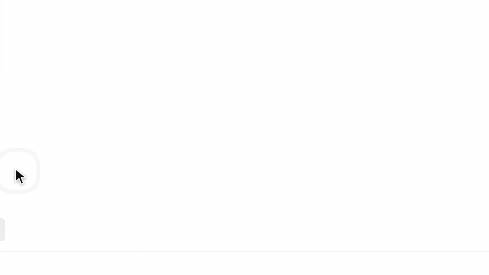

# DSH Mindmap

A persistent Excalidraw canvas for [DSH](https://www.npmjs.com/package/@deepseek-ai/dsh)
where agents draw alongside you: draw a box, say what goes in it, and an agent
takes the box, while a lead agent plans how the boxes work together.



*Six boxes, each asked only "&lt;continent&gt; (see note)". The agents agree on one projection between themselves and draw a single world map, from memory, in under six minutes.*

Needs DSH 0.2.x with its Agent Teams plugin. MIT licensed.

## Install

**Plugins page** (DSH Web or Desktop): open **Plugins** in the sidebar and turn
on **Agent Teams**. Then choose **Add plugin**, paste this address and install:

```
https://github.com/aur3l14no/dsh-mindmap/releases/download/v0.1.0/dsh-mindmap-0.1.0.tgz
```

**Terminal** (a CLI Web profile):

```sh
dsh plugin --profile web add @deepseek-ai/dsh-experimental-agent-team-profile@$(dsh --version)
dsh plugin --profile web add https://github.com/aur3l14no/dsh-mindmap/releases/download/v0.1.0/dsh-mindmap-0.1.0.tgz
dsh web
```

**Ask an agent**: paste this into DSH (Creator mode), Claude Code, Codex or any
coding agent:

```
Install the DSH plugin dsh-mindmap by following
https://raw.githubusercontent.com/aur3l14no/dsh-mindmap/HEAD/docs/install.md
```

Then open **Mindmap** in the sidebar, pick a workspace and create a canvas.
Press **F**, drag a box, type what it should hold and press Enter.

## What a canvas brings

Besides the usual drawing tools (notes, text, shapes, arrows, drag, marquee
select, zoom, undo/redo, autosave):

- **A lead**: every canvas is one DSH Session, shown under the canvas. Talk to
  it there; it is the Team Lead of the agents working on the canvas.
- **Smart boxes**: a box is an Excalidraw frame (the **F** tool). Elements it
  covers belong to it. Draw a box and say what it should hold: a new teammate
  of the lead takes the box, locked to it.
- **Locks**: a locked box, and everything lying in it, can be changed only by
  its holder, the user or one agent. Boxes may overlap; what lies in the
  overlap stays locked to both holders.

Dependencies, relays and conflicts between agents are not a canvas mechanism:
the lead and its teammates settle them with Agent Teams (messages, the task
board), as a team working in one workspace does. Scheduling stays with DSH's
automation tasks.

## Using it

- **Talk to the lead** in the chat under the canvas; drag its top edge to
  resize it.
- **Give a box to an agent**: press **F**, drag a box, type what it should
  make and press Enter (Esc keeps a plain box). A selected box without an
  agent offers **Ask an agent** the same way.
- **Talk to a box's agent**: select its box or click its chip; the chat
  switches to that teammate. The tabs above the chat switch back. Talking is
  how you steer an agent: what you draw on the canvas stays yours, never taken
  as an instruction or moved, and an agent hears what you changed in or beside
  its box the next time it looks. Stopping an agent, deleting its work or
  lifting its lock are decisions the lead respects.
- **Watch agents work**: each agent at work shows as a collaborator cursor
  where it last read or drew, saying what it does or what it tells a teammate
  (dots while it thinks), with what it just changed outlined. Click its avatar
  at the top right to go there.
- **Locks**: select a box and **Lock** it to keep agents out; click a lock
  chip to lift any lock, yours or an agent's.

## Agent tools

Every Session in a workspace that has a canvas gets three tools and a short
canvas policy (claim and lock a box before drawing, message the holder instead
of working around a lock, let the drawing be the report and message others only
when they must act, use only these tools on canvases). Their descriptions,
schemas and errors are the whole contract.

| Tool | Purpose |
| --- | --- |
| `canvas_read` | Who you are on the canvas, its boxes with owner and lock holder, and elements as compact Excalidraw JSON, for the canvas, one box or chosen ids. |
| `canvas_view` | A PNG of the canvas, a box, ids or a region, drawn like the canvas, with optional coordinate grid. |
| `canvas_write` | One atomic batch of creations, partial updates (by `id`), group moves and copies (placed, scaled and turned as a whole), restacking (`above`/`below`), deletions and box locks (`"lock": true/false`). |

An agent locking a box becomes its owner, as does a teammate locking a box the
lead drew for it. Only the holder changes a locked box; the canvas lead may lift
a teammate's lock (locking the box again gives it back to the teammate), and
only the user lifts a lock the user set. Helpers an agent starts write as that
agent.

## Storage

Everything lives in the workspace:

```
.mindmaps/<canvas>/
  canvas.excalidraw   standard Excalidraw scene; boxes keep owner and lock in customData,
                      and "mindmap.sessionId" names the canvas lead Session
  exports/            images rendered by canvas_view
```

Refreshing the page or restarting DSH restores canvases, boxes, locks and the
lead with its team; nothing is replayed.

## Configuration

Set these on the `mindmap` entry in the profile's `cordis.patch.yml`:

```yaml
- id: mindmap
  config:
    fontFiles: [/usr/share/fonts/opentype/noto/NotoSansCJK-Regular.ttc]
```

| Option | Default | Meaning |
| --- | --- | --- |
| `fontFiles` | `[]` | Font files used for images agents see, such as a CJK face. Empty uses the first installed CJK system font. CJK text in Excalifont, the default font, is drawn with Excalidraw's own Xiaolai instead. |
| `teammateProvider` | `spawn` | The subagent provider a box's teammate starts with, as Agent Teams uses for fresh teammates. |

## Development

```sh
npm install --ignore-scripts   # peer dependencies come from DSH
npm run build                  # client bundles and font assets
npm test
npm run parity                 # PNG renderer next to Excalidraw's own export
```

To try a checkout, add it to a profile with
`dsh plugin --profile web add link:$PWD` and rebuild after changes. A release
attaches the built `npm pack` tarball as `dsh-mindmap-<version>.tgz`; update
the address under [Install](#install) to match.

`client.js` registers the page and its embedded conversation;
`client.canvas.js` (Excalidraw) loads on first visit. `index.js` is the Host
plugin: `src/host/` holds the canvas store, lock and write rules, the canvas
team, tools, routes and the PNG renderer; `src/shared/` is used by both sides.

## License

[MIT](LICENSE). Bundled Excalidraw, renderer libraries and fonts keep their own
licenses: see [THIRD_PARTY_NOTICES.md](THIRD_PARTY_NOTICES.md).
